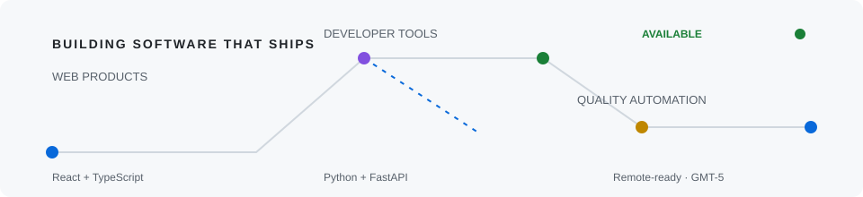
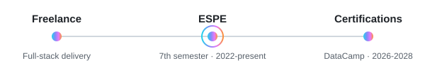

# Pablo Domínguez

**Full-Stack Web Developer** building reliable web products with React, TypeScript, Node.js, and FastAPI.

[Portfolio](https://pablo004.is-a.dev/) · [LinkedIn](https://www.linkedin.com/in/pabl004-dev) · [Email](mailto:pablodo004@gmail.com)

<picture>
  <source media="(prefers-color-scheme: dark)" srcset="assets/profile-hero-dark.svg" />
  
</picture>

> [!NOTE]
> Available for remote junior full-time or part-time roles · Ecuador (GMT-5)

### What I build

<picture>
  <source media="(prefers-color-scheme: dark)" srcset="assets/divider-sober-dark.svg" />
  
</picture>

| Web products | Developer tooling | Quality & delivery |
| --- | --- | --- |
| UI, APIs, data models, authentication and deployment. | Static analysis, CLI, API and MCP integrations. | Automated tests, CI, documentation and live demos. |

### Selected work

<picture>
  <source media="(prefers-color-scheme: dark)" srcset="assets/divider-sober-dark.svg" />
  
</picture>

<table>
<tr>
<td width="50%" valign="top">

#### [Rootline](https://github.com/Pa004/rootline)

Causal evidence analysis for software regressions, ranked from Git history, static analysis and test results.

`Python` `FastAPI` `React` `tree-sitter` `MCP`

`12 CLI commands` · `4 benchmark cases`

[Live demo](https://rootline-73m.pages.dev/) · [Repository](https://github.com/Pa004/rootline)

</td>
<td width="50%" valign="top">

#### [SciKick](https://github.com/Pa004/scikick)

Football analytics with team-specific probabilities, value checks and an accessible bilingual interface.

`React` `TypeScript` `FastAPI` `LightGBM`

`374 backend tests` · `226 frontend tests`

[Live demo](https://scikick.pages.dev/) · [Repository](https://github.com/Pa004/scikick)

</td>
</tr>
<tr>
<td width="50%" valign="top">

#### [Sentinel](https://github.com/Pa004/sentinel)

Architecture erosion detector over dependency graphs, with violation origins from Git history.

`Python` `FastAPI` `React` `Docker`

`8 rules` · `5 languages` · `142 tests`

[Live demo](https://sentinel-zxr.pages.dev/) · [Repository](https://github.com/Pa004/sentinel)

</td>
<td width="50%" valign="top">

#### [phrasecraft](https://github.com/Pa004/phrasecraft)

Offline-first PWA for learning memorable master passphrases through guided recall practice.

`Astro` `Svelte` `PWA` `TypeScript`

`5-stage practice` · `offline-first PWA`

[Live demo](https://phrasecraft.pages.dev/) · [Repository](https://github.com/Pa004/phrasecraft)

</td>
</tr>
</table>

Product previews

### Experience and education

<picture>
  <source media="(prefers-color-scheme: dark)" srcset="assets/divider-sober-dark.svg" />
  
</picture>

<picture>
  <source media="(prefers-color-scheme: dark)" srcset="assets/timeline-v2-dark.svg" />
  
</picture>

**Freelance Full-Stack Developer** · Summer Dent and Roomify  
Delivered frontend, backend, authentication, testing, and deployment work. Summer Dent is a production dental clinic management system.

**Software Engineering Student, 7th semester** · Universidad de las Fuerzas Armadas ESPE  
Scholarship for Academic Distinction · Top quintile of the cohort · 2022-present

**Additional work:** [Eventual](https://github.com/Pa004/Eventual), an academic event-management system built with Flutter, Express, PostgreSQL, and Supabase.

### Core stack

<picture>
  <source media="(prefers-color-scheme: dark)" srcset="assets/divider-sober-dark.svg" />
  
</picture>

**Frontend:** React, TypeScript, Next.js, Tailwind CSS  
**Backend:** Node.js, Express, Python, FastAPI, REST APIs  
**Data and infrastructure:** PostgreSQL, Supabase, SQLite, Docker, Cloudflare  
**Quality:** pytest, Vitest, Cypress, GitHub Actions

### Credentials

<picture>
  <source media="(prefers-color-scheme: dark)" srcset="assets/divider-sober-dark.svg" />
  
</picture>

- [AI Engineer for Developers Associate, DataCamp](https://www.datacamp.com/certificate/AIEDA0010543717785) · June 2026-June 2028
- [Data Engineer Certificate, DataCamp](https://www.datacamp.com/certificate/DE0015585598056) · June 2026-June 2028

Español

Desarrollador web full-stack disponible para roles junior remotos de tiempo completo o medio tiempo. Construyo productos web con React, TypeScript, Node.js y FastAPI, con énfasis en APIs, datos, pruebas y despliegue.

Proyectos principales: [Rootline](https://github.com/Pa004/rootline), [SciKick](https://github.com/Pa004/scikick), [Sentinel](https://github.com/Pa004/sentinel) y [phrasecraft](https://github.com/Pa004/phrasecraft). Más proyectos y demos en mi [portafolio](https://pablo004.is-a.dev/).

GitHub activity

<picture>
  <source media="(prefers-color-scheme: dark)" srcset="assets/snake-dark.svg" />
  
</picture>

