# Pablo Domínguez

**Full-Stack Web Developer** building reliable web products with React, TypeScript, Node.js, and FastAPI.

Available for remote junior full-time or part-time roles · Ecuador (GMT-5)

[Portfolio](https://pablo004.is-a.dev/) · [LinkedIn](https://www.linkedin.com/in/pabl004-dev) · [Email](mailto:pablodo004@gmail.com)

## What I build

- End-to-end web applications: product UI, APIs, data models, authentication, and deployment.
- Developer tooling that makes codebases easier to inspect, test, and maintain.
- Tested, documented software with CI and live demos where they add value.

## Selected work

### [Rootline](https://github.com/Pa004/rootline)
Causal evidence analysis for software regressions. Combines Git history, static analysis, test results, and a React evidence graph to rank candidate changes with inspectable reasoning.

`Python` `FastAPI` `React` `tree-sitter` `MCP` `PyPI`

[Live demo](https://rootline-73m.pages.dev/) · [Repository](https://github.com/Pa004/rootline)

### [SciKick](https://github.com/Pa004/scikick)
Football analytics product with team-specific probabilities, value checks, and an accessible bilingual interface. Built as a React and FastAPI system with automated data pipelines and Cloudflare deployment.

`React` `TypeScript` `FastAPI` `SQLite` `LightGBM` `Cloudflare`

[Live demo](https://scikick.pages.dev/) · [Repository](https://github.com/Pa004/scikick)

### [Sentinel](https://github.com/Pa004/sentinel)
Architecture erosion detector for TypeScript, JavaScript, Python, Java, and C#. It analyzes dependency graphs, finds structural violations, and tracks their origin through Git history.

`Python` `FastAPI` `React` `tree-sitter` `Docker` `GitHub Actions`

[Live demo](https://sentinel-zxr.pages.dev/) · [Repository](https://github.com/Pa004/sentinel)

### [phrasecraft](https://github.com/Pa004/phrasecraft)
Offline-first PWA for learning memorable master passphrases through guided recall practice.

`Astro` `Svelte` `PWA` `TypeScript` `Cloudflare`

[Live demo](https://phrasecraft.pages.dev/) · [Repository](https://github.com/Pa004/phrasecraft)

## Experience and education

**Freelance Full-Stack Developer** · Summer Dent and Roomify  
Delivered frontend, backend, authentication, testing, and deployment work. Summer Dent is a production dental clinic management system.

**Software Engineering Student, 7th semester** · Universidad de las Fuerzas Armadas ESPE  
Scholarship for Academic Distinction · Top quintile of the cohort · 2022-present

**Additional work:** [Eventual](https://github.com/Pa004/Eventual), an academic event-management system built with Flutter, Express, PostgreSQL, and Supabase.

## Core stack

**Frontend:** React, TypeScript, Next.js, Tailwind CSS  
**Backend:** Node.js, Express, Python, FastAPI, REST APIs  
**Data and infrastructure:** PostgreSQL, Supabase, SQLite, Docker, Cloudflare  
**Quality:** pytest, Vitest, Cypress, GitHub Actions

## Credentials

- [AI Engineer for Developers Associate, DataCamp](https://www.datacamp.com/certificate/AIEDA0010543717785) · June 2026-June 2028
- [Data Engineer Certificate, DataCamp](https://www.datacamp.com/certificate/DE0015585598056) · June 2026-June 2028

Español

Desarrollador web full-stack disponible para roles junior remotos de tiempo completo o medio tiempo. Construyo productos web con React, TypeScript, Node.js y FastAPI, con énfasis en APIs, datos, pruebas y despliegue.

Proyectos principales: [Rootline](https://github.com/Pa004/rootline), [SciKick](https://github.com/Pa004/scikick), [Sentinel](https://github.com/Pa004/sentinel) y [phrasecraft](https://github.com/Pa004/phrasecraft). Más proyectos y demos en mi [portafolio](https://pablo004.is-a.dev/).

GitHub activity

<picture>
  <source media="(prefers-color-scheme: dark)" srcset="assets/snake-dark.svg" />
  
</picture>

